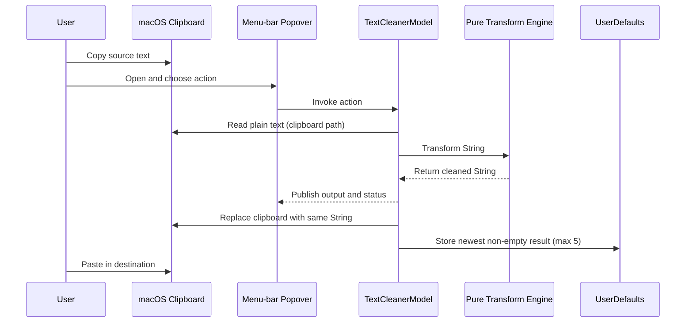

# TextCleaner Product and Industry Report

- **Evidence snapshot:** 2026-07-20, commit `81fd13a`
- **Product version inspected:** 1.1.0, build 2
- **Release status:** mechanically healthy, formally `DO-NOT-SHIP` pending interactive QA
- **Audience:** prospective users, product owners, founders, developers, operators, and industry peers

## Evidence standard

This is an evidence-based assessment of the current repository, not a market-sizing exercise or promotional brief. Important claims use these labels:

- **Implemented** — evidenced in current code, tests, configuration, or packaged artifacts.
- **Verified** — exercised successfully during this inspection or directly recorded as performed in release QA.
- **Partial** — present but incomplete, fragile, or not fully validated.
- **Planned** — documented intention absent from the current product.
- **Inferred** — a reasoned product interpretation without direct user-research evidence.
- **Unknown** — not established by the available material.

No external competitor research, customer interviews, market data, or usage analytics were provided or performed. Comparisons below therefore concern general workflow categories, not claims about specific vendors.

## 1. Executive summary

### One-sentence description

TextCleaner is a local macOS menu-bar utility that turns messy copied text into clean, paste-ready plain text or lightweight formatted text.

### Elevator pitch

Copy awkward text from a PDF, website, email, or message; open TextCleaner; choose the cleanup you need; then paste the result wherever you were already working. The same text shown in the output is copied back to the clipboard, and the latest five cleaned results remain available for quick reuse.

### Plain-English explanation

Text often arrives with the wrong spaces, hard line breaks, capitalization, or formatting. TextCleaner gives the user one compact place to repair those issues. It can collapse extra whitespace, join PDF-wrapped lines, convert case, create simple Markdown, add chat-style formatting, preview the result, and copy it immediately.

It does this locally with fixed rules. It is not generative AI, it does not send text to a server, and it does not require an account.

### Target users

- **Primary, inferred:** Mac users who frequently copy text from PDFs, websites, documents, email, or chat and need to paste it elsewhere cleanly.
- **Secondary, inferred:** writers, researchers, students, operators, support staff, marketers, and developers who repeatedly reformat lines for Markdown or chat tools.
- **Not established:** which group is largest, how often they experience the problem, or whether they will install a standalone utility to solve it.

### Problem and value proposition

The problem is small but concrete: copied text often needs repetitive cleanup between copy and paste. The product's value is reducing that interruption to a predictable local action with a visible result and clipboard handoff.

The strongest implemented differentiator is not a novel algorithm. It is the combination of:

- a dedicated menu-bar surface;
- deterministic, offline transforms;
- output automatically returned to the clipboard;
- a visible preview and status;
- five persistent recent outputs;
- both cleanup and destination-oriented Markdown/chat formatting.

### Current stage and verdict

TextCleaner is a coherent early utility with a real application, automated core tests, versioned artifacts, and reproducible packaging. It is beyond a static prototype. It is not yet a credible public release under its own repository rules because the installed-app interaction checklist is incomplete and formally marked `DO-NOT-SHIP`.

**Overall verdict:** technically promising and appropriately scoped, but release validation and distribution trust must be resolved before broader promotion. The next win is not more features; it is proving the existing loop end to end, fixing two known transformation defects, and making installation trustworthy.

## 2. The problem and alternatives

### 2.1 The user problem

The README identifies the input contexts as PDFs, websites, emails, and messages. These sources commonly produce one or more of the following frictions:

- visual line wraps copied as real newline characters;
- duplicated or non-breaking spaces;
- all-uppercase passages;
- rich formatting that should become plain text;
- multiple lines that need to become bullets, a comma list, a quote, or inline formatting;
- repeated switching between source, temporary editor, and destination.

**Implemented response:** TextCleaner accepts clipboard or manually edited text and exposes purpose-specific transforms in one menu-bar popover.

**Inferred significance:** for an occasional copy, manual editing is tolerable. The value grows with repetition: reading long PDFs, preparing notes, transferring lists, responding in chat, or authoring Markdown. The repository contains no evidence quantifying frequency, time saved, error reduction, or user frustration.

### 2.2 Existing substitute workflows

The product competes with behaviors as much as with applications:

| Alternative category | What it solves | Why TextCleaner may be better | Where the alternative may remain better |
|---|---|---|---|
| Paste as plain text | Removes rich styling. | TextCleaner also repairs whitespace, line breaks, case, and destination formatting. | A keyboard paste command is faster when styling is the only problem. |
| Temporary plain-text editor | Lets users inspect and manually edit copied text. | TextCleaner offers repeatable one-click operations and copies results automatically. | Manual editing handles ambiguous or document-specific cases more accurately. |
| Find/replace or scripts | Can automate custom patterns. | TextCleaner is discoverable and does not require scripting knowledge. | Scripts are more flexible, composable, and scalable for expert users. |
| Clipboard manager | Stores and reuses clipboard history. | TextCleaner changes text intentionally and keeps only five cleaned outputs. | Full clipboard managers offer deeper search, history, and cross-device features. |
| General writing or AI tool | Can rewrite, correct, or restructure text semantically. | TextCleaner is local, deterministic, instant, and has no variable inference. | Semantic tools can handle grammar, meaning, tone, and ambiguous formatting that fixed rules cannot. |
| Built-in Markdown/chat formatting | Formats text inside the destination. | TextCleaner can prepare content before opening or switching destination context. | Native formatting is more accurate for the destination and may avoid visible markup characters. |

TextCleaner's case is strongest when users want repeatable mechanical cleanup, not semantic rewriting. If the main job is merely “paste without formatting,” a dedicated app may be excessive. If the job is complex editing, TextCleaner is too narrow. Its useful middle ground must be validated with real repeated workflows.

### 2.3 Urgency, frequency, and cost

- **Frequency:** unknown. The product assumes this is a repeated annoyance for its target users.
- **Urgency:** usually low per incident; potentially high during document-heavy workflows.
- **Direct monetary cost:** unknown and probably small for individuals.
- **Cognitive cost, inferred:** context switching and repetitive micro-editing are the main burdens.
- **Strategic importance:** low as a standalone problem, unless the utility becomes part of a broader productivity workflow or earns strong habitual use.

This is a convenience product, not a mission-critical platform. That is not a weakness if its speed and reliability are excellent; it does mean installation friction can easily outweigh perceived value.

## 3. Users and use cases

The user groups below are hypotheses grounded in the implemented tools and README examples. They are not validated personas.

### 3.1 Primary user: document-heavy knowledge worker

**Status:** inferred.

- **Context:** reads PDFs, reports, academic papers, browser pages, or email and moves excerpts into notes or documents.
- **Goal:** paste readable paragraphs without hard wraps, stray spaces, or accidental rich styling.
- **Frustration:** every excerpt requires cleanup before it can be reused.
- **Discovery/onboarding:** downloads DMG/ZIP, installs the menu-bar utility, launches it, and learns the visible action labels.
- **Scenario:** copy a hard-wrapped paragraph from a PDF → open TextCleaner → press PDF Lines or Smart Clean → inspect output → paste into notes.
- **Value:** less manual line joining and a predictable clipboard result.
- **Return motivation:** the utility remains one click away whenever source formatting is poor.
- **Boundary:** current PDF heuristics can mis-handle ambiguous paragraph/list boundaries, and wrapped bullet continuations have a known bug.

### 3.2 Secondary user: writer or Markdown author

**Status:** inferred.

- **Context:** prepares text for documentation, issue trackers, READMEs, forums, or note systems.
- **Goal:** quickly convert line-oriented text to quotes, bullets, comma lists, bold, italic, or inline code.
- **Scenario:** copy several unformatted item lines → open TextCleaner → choose Markdown Bullet List → paste into the destination.
- **Value:** replaces repetitive prefix/wrapper typing.
- **Return motivation:** a consistent tool for recurring formatting transformations.
- **Boundary:** TextCleaner does not parse Markdown structure, escape every delimiter case, or render a Markdown preview.

### 3.3 Secondary user: chat-heavy operator

**Status:** inferred.

- **Context:** writes support, community, operations, or team-chat messages in tools that accept lightweight markup.
- **Goal:** prepare bold, italic, monospace, or strikethrough text quickly.
- **Scenario:** paste a response draft → select Chat Monospace for a line → paste the marked-up text into chat.
- **Value:** destination-friendly markup without remembering each delimiter.
- **Boundary:** formatting conventions vary by chat application; the repository does not verify compatibility with named destinations.

### 3.4 Secondary user: developer or technical operator

**Status:** inferred.

- **Context:** converts logs, file lists, snippets, commands, or ticket text.
- **Goal:** normalize whitespace, create comma-separated values, or wrap code-like lines.
- **Value:** small deterministic operations without opening an IDE or writing a one-off command.
- **Boundary:** the comma-list feature is not CSV-safe, and inline-code handling is pragmatic rather than a complete Markdown algorithm.

### 3.5 Future user: keyboard-first power user

**Status:** planned, not served by the current build.

The roadmap defines Control-Shift-Command-C as a system-wide Smart Clean shortcut. That journey would reduce copy → clean → paste to one keystroke between copy and paste. The implementation was reverted because the full live verification could not be performed, so the current user still must open the menu-bar popover.

### 3.6 Users and jobs not served

TextCleaner is not currently suitable for:

- users on Windows, Linux, iPhone, iPad, or Intel-only Macs;
- collaborative editing, shared history, or cross-device synchronization;
- semantic proofreading, rewriting, summarization, translation, or tone changes;
- preserving rich-text styles, images, attachments, tables, or document layout;
- regulated workflows requiring guaranteed secure deletion, audit logs, policy controls, or formal data-loss prevention;
- large-scale batch processing or command-line automation;
- users who need custom transformation rules or scripted pipelines.

## 4. Product experience

### 4.1 Installation and first value

The current distribution consists of versioned DMG and ZIP files. A user drags `TextCleaner.app` to Applications and launches it. The app is ad-hoc signed and not notarized, so an internet-downloaded copy may require Control-click → Open.

**Trust implication:** this is a substantial first-run cost for a small clipboard utility. Clipboard access is inherently sensitive, and an unidentified-developer warning appears at exactly the moment a user is deciding whether to trust the app.

After launch, the app appears only in the menu bar. It intentionally has no Dock icon or app-switcher presence. The user clicks the `text.badge.checkmark` item to open a single popover.

There is no tutorial, permission prompt, settings screen, sample content, or guided onboarding. The control labels and initial status are expected to teach the product. This is plausible for a utility of this size, but unverified with new users.

### 4.2 Primary journey: clean what is already copied

1. Copy messy text in any application.
2. Open the TextCleaner menu-bar popover.
3. If the input was empty, it preloads the plain-text clipboard into both input and output.
4. Press `Clean Clipboard`.
5. Smart Clean normalizes spacing and line breaks, and sentence-cases mostly-uppercase content.
6. The output panel shows the result.
7. The same result is placed on the clipboard.
8. Status says it was cleaned and copied.
9. The result becomes the newest recent output.
10. Return to the destination and paste.

The core value moment is step 7: the tool does not merely preview a transformation; it completes the handoff back to the user's existing workflow.

### 4.3 Secondary journey: choose a precise transform

1. Open the popover and let it load clipboard text, press Paste, or type/edit directly.
2. Choose Plain Text, PDF Lines, Smart Clean, Sentence, a Case option, a Markdown option, or a Chat option.
3. The app updates the output, status, clipboard, and recent history immediately.
4. Optionally press Copy again or select an earlier recent.
5. Paste into the destination.

This path trades the speed of one default action for explicit control. The grouping is sensible: three common cleanup buttons, one sentence control, and menus for larger sets of related formatters.

### 4.4 Surface and state behavior

The 540-point popover presents:

- title, status, and Quit;
- a full-width monospaced input editor;
- clipboard controls;
- transformation controls;
- a scrollable monospaced output;
- five recent outputs or a useful empty-state message.

The input width was corrected in the latest commit so it aligns with the output panel rather than ending early.

There are no loading states because operations are local and synchronous. Error communication uses status text and a system beep. No modal dialogs interrupt the flow.

### 4.5 Empty, error, permission, and recovery states

| State | Current behavior | Assessment |
|---|---|---|
| No plain clipboard text | Status says `Clipboard has no plain text.` and the app beeps. | Clear, lightweight recovery: copy text and retry. |
| Empty input | Transform buttons/menus are disabled. | Prevents meaningless actions in normal UI use. |
| Empty output | Placeholder text is shown and Copy is hidden. | Clear empty state. |
| No recents | Explains that recent cleaned text will appear there. | Clear empty state. |
| Clipboard write failure | Status says `Could not copy text.` and the app beeps. | Honest, but output has already changed, so the literal clipboard/output promise is temporarily broken. |
| Clear | Empties input/output and sets `Cleared.` | Does not clear clipboard or persisted recents; this may surprise privacy-conscious users. |
| Relaunch | Restores five recents; current input/output are not restored. | Reasonable for a small utility. |
| Permissions | Normal use has no special permission flow. | The recorded Accessibility denial affected test automation, not ordinary clipboard use. |

### 4.6 What feels trustworthy and what feels fragile

**Trustworthy:** visible output before paste, deterministic rules, local processing, explicit status, compact history, no account, no server dependency, and documented release failures.

**Fragile:** unidentified-developer installation, known transformation edge cases, no in-app explanation of Smart Clean heuristics, no clear-recents control, no completed interaction QA, and no global shortcut despite the product promise mentioning one in the roadmap.

## 5. Product capabilities

| Capability | User benefit and high-level operation | Status | Current limitation |
|---|---|---|---|
| Clipboard preload | Opens copied plain text in the editor/output when current input is empty. | **Implemented; model-tested; UI QA incomplete** | Existing non-empty input prevents auto-replacement; image-only clipboard produces an error. |
| Paste button | Explicitly replaces input/output with current clipboard text. | **Implemented; UI QA incomplete** | Reads only plain string content. |
| Clean Clipboard | Smart-cleans the current clipboard and copies it back. | **Implemented; core path model-tested** | No global invocation in current build; actual release-button interaction not completed in QA. |
| Plain Text | Normalizes newline forms, non-breaking spaces, inline whitespace, and outer whitespace. | **Implemented; tested** | Rich content is reduced to the plain string supplied by macOS. |
| PDF Lines | Repairs hard wraps, paragraph breaks, basic bullets, numbered lists, and split hyphenation. | **Partial; tested for current behavior** | Known wrapped-bullet continuation bug is not fixed. Heuristics can misread ambiguous boundaries. |
| Smart Clean | Runs normalization and PDF repair, then sentence-cases mostly-uppercase text. | **Implemented; tested** | Fixed heuristic; can damage intended capitalization, acronyms, or proper nouns. |
| Sentence Case | Lowercases and capitalizes after sentence-ending punctuation. | **Implemented; tested** | Not grammar-, abbreviation-, name-, or locale-aware. |
| Title Case | Capitalizes words with a fixed small-word list. | **Partial; tested for current behavior** | Known multi-line bug; limited punctuation/style rules. |
| Lowercase / Uppercase | Applies native Swift casing. | **Implemented** | Model routing is present; these actions lack dedicated clipboard integration checks. |
| Markdown Quote | Prefixes every normalized line with quote syntax. | **Implemented; tested** | Does not understand existing Markdown nesting. |
| Markdown Bullet List | Prefixes meaningful lines with `- `. | **Implemented; tested** | Does not detect existing bullets or preserve blank entries. |
| Comma List | Joins meaningful lines with comma-space. | **Implemented; tested** | Not CSV-safe and does not escape embedded commas. |
| Markdown Bold / Italic / Code | Wraps meaningful lines with appropriate delimiters. | **Implemented; tested** | Limited delimiter escaping; no rendered preview. |
| Chat formatting | Adds conventional bold, italic, monospace, or strikethrough markers. | **Implemented; tested** | Destination compatibility is assumed, not verified. |
| Output preview and Copy | Shows selectable monospaced output and permits recopy. | **Implemented; UI QA incomplete** | Fixed-height scroll area; no diff or undo. |
| Recent outputs | Keeps five unique, newest-first cleaned values across relaunches and allows recopy. | **Implemented; model-tested** | No clear-history control, no search, and stored values are trimmed. |
| Clear | Resets current input/output and status. | **Implemented; model-tested** | Does not erase clipboard or recents. |
| Menu-bar accessory mode | Keeps the app out of the Dock and app switcher. | **Implemented; release-verified** | Discoverability can be lower than a conventional app. |
| Global Control-Shift-Command-C | Would Smart Clean from any app and play success/error feedback. | **Planned, not shipped** | Live end-to-end verification was blocked; current app imports no Carbon and registers no hotkey. |

## 6. Product and technical architecture

### 6.1 Accessible technical overview

TextCleaner is a native macOS application written in Swift. SwiftUI defines the menu-bar interface, while AppKit supplies clipboard, sound, lifecycle, and accessory-app behavior. Foundation supplies all string processing and local preferences.

There is no backend. “Local-only” means the copied text is processed in the app process on the Mac; there is no HTTP client, API key, account, remote model, database server, or vendor SDK in the inspected code.

### 6.2 Data flow

Manual editor actions skip the clipboard read but follow the same transform → output → clipboard → recent path.

### 6.3 Sources of truth

- input, output, and status live in one application model;
- the system pasteboard is the source for copied input and destination for paste-ready output;
- a `UserDefaults` string array is the source for persistent recents;
- the Xcode project version controls bundle version and release filenames;
- source and tests define behavior; plan files define intention, not shipped code.

### 6.4 Local, remote, automated, and manual boundaries

- **Local:** all product functionality and persistence.
- **Remote:** none implemented.
- **Automated:** Release compilation, 45 tests, app copying, DMG/ZIP creation, and mechanical artifact validation commands.
- **Manual:** actual popover interaction, paste into other apps, visual layout, sounds, menu-bar behavior, and cross-app hotkey behavior.

### 6.5 Privacy and security

**Positive:** no network exfiltration path is visible in the repository. No account, authentication secret, token, or external processor exists. This meaningfully reduces vendor and data-handling risk.

**Important qualification:** the last five cleaned outputs persist locally in standard user defaults. These may contain confidential text. There is no encryption added by the app, no automatic expiry, no “clear history,” and no opt-out. The system clipboard is also shared state visible to other local processes under macOS clipboard rules.

**Distribution security:** the app is ad-hoc signed, not Developer ID signed, and not notarized. The signature validates bundle integrity locally but does not establish a trusted publisher identity for external users.

### 6.6 Reliability, latency, scale, and cost

- **Latency:** expected to be low for ordinary text because every operation is in-process and algorithmic. No performance benchmark exists.
- **Large inputs:** all transformation and clipboard work occurs synchronously on the main actor. Very large text may block the interface; this is unmeasured.
- **Scale:** the product is single-user and local. Server scalability is irrelevant. Product scaling pressure will come from UI complexity and transformation correctness, not infrastructure throughput.
- **Operating cost:** effectively no per-user cloud cost in the current design. Costs are development, signing/notarization, distribution, support, and maintenance.
- **Availability:** no remote outage risk. Availability depends on macOS compatibility, correct clipboard behavior, and the app process running.

For deeper implementation detail, see `REPOSITORY-LEARNING-REPORT.md`.

## 7. Differentiation and positioning

### 7.1 Positioning statement

For Mac users who repeatedly move badly formatted text between applications, TextCleaner is a lightweight menu-bar cleanup step that produces a visible, paste-ready result locally. Unlike a generic editor or semantic writing assistant, it focuses on fast, deterministic clipboard transformations without an account or cloud service.

This is a proposed positioning, not a validated marketing claim.

### 7.2 What is differentiated today

| Differentiator | Exists today? | Strength |
|---|---|---|
| Local deterministic processing | Yes | Credible and supported by source; valuable for speed, predictability, and privacy. |
| Output automatically copied | Yes | Strong workflow detail; model-tested on core paths. |
| Menu-bar access | Yes | Convenient and persistent without Dock clutter. |
| Cleanup plus Markdown/chat formatters | Yes | Broadens utility without requiring multiple tools. |
| Five cleaned recents | Yes | Useful lightweight recovery/reuse loop. |
| One global shortcut from any app | No | Planned, but absent from current binary. |
| Correct wrapped PDF bullets | No | Planned fix did not ship. |
| Trusted, frictionless distribution | No | Ad-hoc and unnotarized. |

### 7.3 Defensibility

The algorithms and UI are technically easy to copy. There is no proprietary model, network effect, unique dataset, integration moat, or platform lock-in evidenced in the repository.

Potential defensibility would need to be experiential or distributional:

- exceptional reliability on real messy-text examples;
- a highly polished keyboard-first loop;
- memorable presets tuned to actual destinations;
- trust earned through transparent local processing and signed distribution;
- habitual menu-bar placement;
- a curated regression corpus derived from user-reported failures.

These advantages accumulate through product execution and learning, not through the current code alone.

### 7.4 Positioning risks

- If users only need plain-text paste, TextCleaner is more effort than a built-in command.
- If users need semantic rewriting, fixed rules are insufficient.
- If installation requires bypassing Gatekeeper, many prospective users may abandon the product before seeing value.
- If Smart Clean changes names/acronyms or PDF Lines breaks list structure, users may stop trusting automatic clipboard replacement.
- If destination-specific markup varies, generic “Chat” formatting can feel unreliable.

### 7.5 Evidence needed to validate positioning

1. Ten to twenty observed target users performing real copy-clean-paste tasks.
2. A corpus of anonymized or synthetic representative inputs and desired outputs.
3. Task completion time/error comparison against users' current workflow.
4. Repeat use over several weeks, not only first-run satisfaction.
5. Transform-selection frequency and failure reports, collected without capturing clipboard content.
6. Installation completion rate before and after notarized distribution.

## 8. Maturity, quality, and trust

### 8.1 What genuinely works

**Mechanically verified on 2026-07-20:**

- current Release source builds;
- all 45 current unit/model checks pass;
- the app bundle is arm64, version 1.1.0/build 2, and minimum macOS 13;
- the app bundle's strict signature check passes;
- the DMG checksum is valid;
- the ZIP contains a complete app and passes decompression testing;
- the app extracted from the ZIP passes signature and metadata checks.

**Directly verified in committed release QA on 2026-07-11:**

- DMG installation layout and copy to Applications;
- installed app launch and menu-bar item presence;
- accessory activation/no-Dock behavior;
- installed version metadata.

**Mechanically covered in tests:** core transform examples, central clipboard success paths, and recent history behavior.

### 8.2 What remains prototype-level or incomplete

- installed-app control interactions lack completed release QA evidence;
- two known transform bugs remain;
- the planned one-keystroke global shortcut is absent;
- distribution uses ad-hoc signing and no notarization;
- the product has no settings, clear-history action, support surface, diagnostics, updater, or feedback loop;
- there is no CI, UI automation, crash reporting, or performance evidence;
- user need and retention are unvalidated.

### 8.3 Understanding the `DO-NOT-SHIP` verdict

The verdict is intentionally conservative. Release rows 5–15 and 18–20 were recorded as failures because the automation session lacked macOS Accessibility permission and could not click or inspect the popover. Rows 16–17 were not applicable because the hotkey was not shipped.

This does **not** establish that every blocked UI feature malfunctioned. It establishes that the required evidence was not obtained. The correct next step is direct human QA in a normal session, not relabeling the rows from source inspection.

### 8.4 Where users may lose trust

1. **Gatekeeper warning:** clipboard software from an unidentified developer asks for a high level of implicit trust.
2. **Automatic overwrite:** successful actions replace the clipboard immediately; an unexpected transform can overwrite the user's original copied value, although input/output still show it during the session.
3. **Known incorrect transformations:** bullet continuations and multi-line title case visibly violate user intent.
4. **Silent heuristic:** Smart Clean's uppercase threshold is not explained in the interface.
5. **Persistent sensitive recents:** cleaned content survives relaunch without an erase-history control.
6. **Literal promise vs failure path:** if the OS pasteboard write fails, output can change while clipboard does not.

### 8.5 Quality assessment

The implementation quality is stronger than the product maturity. The source is small, readable, separated by responsibility, dependency-free, and guarded by exact tests. The repository also preserves negative QA evidence. The largest quality gap is interaction validation: the code is easier to trust than the current release claim.

## 9. Feasibility and longevity

### 9.1 Technical feasibility

**High.** The current product is already implemented using stable first-party macOS APIs. The remaining known work—transform corrections, QA, hotkey registration, better history controls, and trusted signing—is technically ordinary for a native Mac utility.

The global hotkey feasibility probe returned success and the planned code typechecked before being reverted. Its uncertainty is end-to-end behavior and conflict/error handling, not basic API availability.

### 9.2 Dependency and vendor risk

- **Third-party dependency risk:** very low; there are no third-party packages.
- **Cloud/vendor API risk:** none in the current product.
- **Platform risk:** medium; the product is macOS-only and relies on SwiftUI `MenuBarExtra`, AppKit pasteboard behavior, and Apple distribution/security systems.
- **Toolchain risk:** low to medium; building requires Xcode on macOS, and there is no CI matrix across OS/toolchain versions.

### 9.3 Data quality

The product does not rely on an external dataset. Its “data quality” problem is the diversity of messy text inputs. A few hand-written tests cannot represent PDF generators, languages, punctuation styles, lists, OCR output, code, and destination markup.

A durable product needs a regression corpus of representative, privacy-safe examples. Each reported failure should become a named input/output case before algorithm changes.

### 9.4 Cost and maintenance

Current runtime infrastructure cost is approximately zero. The maintenance burden is concentrated in:

- macOS and Xcode compatibility;
- code signing/notarization and release procedure;
- transformation edge cases;
- support for destination formatting conventions;
- human QA of menu-bar and cross-app behavior.

The small codebase can remain maintainable if feature count stays disciplined. Adding arbitrary presets, scripting, sync, or AI would multiply support and privacy obligations.

### 9.5 Licensing, privacy, and regulatory considerations

- No repository license file was found. **Unknown:** whether external users may legally redistribute or contribute to the source. If the repository is intended to be public, an explicit license decision is required.
- No third-party code or service licensing burden is visible.
- Local clipboard/history processing reduces remote privacy obligations, but locally persisted recents may still contain personal or confidential information.
- No regulatory compliance claims should be made. The app lacks retention controls, audit features, enterprise policy, and formal security review.

### 9.6 Likely failure modes

| Failure mode | Likelihood/impact assessment | Mitigation |
|---|---|---|
| Heuristic transform changes intended meaning | Medium likelihood, medium trust impact | Preview remains visible; add regression corpus, undo/restore, and narrower rules. |
| Clipboard contains no string | Normal edge case, low impact | Existing status + beep; keep original clipboard untouched. |
| Clipboard write fails | Low/unknown likelihood, high contract impact | Testable clipboard adapter and atomic model update semantics. |
| Very large text freezes UI | Unknown likelihood, medium impact | Benchmark realistic maximums; move pure work off main actor if needed. |
| Hotkey conflicts with another app | Relevant only if planned feature ships | Check and surface Carbon registration errors; offer a configurable shortcut if product scope permits. |
| macOS distribution warning blocks adoption | High likelihood for downloaded current build, high impact | Developer ID signing and notarization. |
| Sensitive text remains in recents | Context-dependent, medium privacy impact | Clear-recents control, optional history, transparent disclosure. |
| macOS update changes menu-bar behavior | Low to medium long-term likelihood | Maintain a supported-OS test matrix and release smoke test. |

### 9.7 Sustainability assessment

TextCleaner can be technically durable because it has no server bill, vendor dependency, or complex data model. Commercial durability is unknown. A small local utility can succeed as a focused paid tool, bundle feature, open-source project, or personal utility, but the repository has no pricing, distribution, acquisition, retention, or customer-support evidence.

The product should earn complexity only after it proves habitual use.

## 10. Roadmap and priorities

This roadmap separates release-critical evidence from product expansion.

### Milestone 0 — establish a truthful release candidate

**Priority:** immediate.

**Goal:** convert unknown interactive behavior into observed results.

1. Run every blocked `RELEASE-QA.md` row through direct human interaction against an app installed from the DMG.
2. Record exact outcomes without assuming source correctness.
3. Fix any observed release-blocking defects with regression tests.
4. Rebuild artifacts and rerun the entire checklist after a code change.
5. Change verdict to `SHIP` and create `v1.1.0` only if every applicable row passes.

**Evidence of completion:** all applicable rows are genuine passes, verdict is `SHIP`, matching tag exists, and `make verify` remains green.

### Milestone 1 — retire known correctness defects

**Priority:** release-critical for advertised behavior.

**Goal:** make PDF bullets and multi-line title case match their stated tools.

1. Apply the scoped fixes in `PLAN-fix-transform-bugs.md`.
2. Keep the five specified regression checks, bringing the suite to 50.
3. Perform the required visual PDF Lines spot check.
4. Add real-world cases for punctuation, numbered continuations, and multi-line title input.

**Evidence of completion:** 50+ green checks and observed correct output in the actual popover.

### Milestone 2 — improve distribution trust and privacy control

**Priority:** high before broad external distribution.

**Goal:** reduce abandonment and clarify local data behavior.

1. Decide the intended distribution channel and acquire Developer ID signing/notarization if distributing outside a private circle.
2. Validate Gatekeeper behavior on a freshly downloaded artifact.
3. Add a Clear Recents action.
4. Explain that five outputs persist locally; consider an opt-out only if users value it.
5. Publish artifact checksums and short release notes.

**Evidence of completion:** normal double-click launch without unidentified-developer workaround, clear history verified, and privacy wording matches behavior.

### Milestone 3 — deliver the one-action promise

**Priority:** high user value, after the existing UI is trusted.

**Goal:** complete the keyboard-first copy → invoke once → paste loop.

1. Revisit `PLAN-clipboard-hotkey.md` in a session where live cross-app QA is possible.
2. Validate success sound, cleaned paste, shared output/status/recent state, no-text error, and quit/unregistration behavior.
3. Check registration return values and make conflicts visible rather than silent.
4. Decide, through user evidence, whether the shortcut must be configurable.

**Evidence of completion:** the eight-step manual flow passes in multiple destination apps and on supported macOS versions.

### Milestone 4 — build a product learning loop

**Priority:** before expanding the feature catalog.

**Goal:** discover whether this is a habit and which transform matters.

1. Observe 10–20 target users doing real tasks.
2. Collect privacy-safe failure examples and turn them into regression fixtures.
3. Measure time-to-first-clean, successful paste rate, repeated weekly use, and most-used action without storing clipboard contents.
4. Test whether the menu-bar interaction is fast enough or whether the hotkey drives retention.
5. Ask which current controls are confusing or unused.

**Evidence of completion:** repeat-use cohort, ranked jobs-to-be-done, and a regression corpus tied to user failures.

### Milestone 5 — polish only where evidence points

Possible later work:

- action keyboard shortcuts and accessibility review;
- a restore-original or undo affordance;
- better case rules and destination-specific presets;
- configurable recent-history behavior;
- automated UI smoke tests and OS-version matrix;
- large-input performance work if measurement warrants it.

### Features to defer

Defer accounts, cloud sync, team collaboration, AI rewriting, a plugin system, arbitrary scripting, and large settings architecture. None is necessary to prove the central product loop, and each would weaken the current simplicity/privacy advantage.

## 11. Communication pack

All copy below is constrained to current implemented behavior. It intentionally does not advertise a global hotkey or claim release approval.

### 11.1 Website introduction

> **Clean copied text before you paste it.**
>
> TextCleaner is a small macOS menu-bar utility for fixing awkward spaces, PDF line breaks, capitalization, Markdown, and chat formatting. Preview the result, then paste it anywhere—the cleaned text is copied back to your clipboard automatically. Processing stays on your Mac.

Suggested trust note for the current artifact:

> Current builds are for Apple Silicon Macs running macOS 13 or later. Version 1.1.0 is ad-hoc signed and not notarized, so macOS may require Control-click → Open.

### 11.2 User-facing product explanation

TextCleaner helps when copied text is almost right but needs cleanup before reuse. Copy text from a PDF, website, email, or message; open the menu-bar popover; and choose the transformation you want. You can normalize spaces, repair common PDF line wraps, change capitalization, create Markdown, or add lightweight chat formatting. The output is visible and automatically copied, and your five latest cleaned results remain available locally.

### 11.3 Technical explanation for industry peers

TextCleaner is a native macOS 13+ SwiftUI menu-bar application with a pure Foundation transformation core and an AppKit-backed observable model. All transforms are deterministic in-process string operations. The model centralizes `NSPasteboard` reads/writes and stores a five-entry recent list in `UserDefaults`. There is no server, account, third-party dependency, telemetry SDK, or remote API. A standalone `swiftc` runner provides 45 transform/model checks, and a shell script builds versioned DMG/ZIP artifacts.

### 11.4 Thirty-second pitch

Copied text often carries bad spacing, hard PDF wraps, shouting capitalization, or the wrong markup. TextCleaner sits in the Mac menu bar, fixes those problems with deterministic local rules, shows the result, and puts that result straight back on the clipboard. It is a focused bridge between copy and paste—not an editor, cloud service, or AI rewrite tool.

### 11.5 Three concrete user stories

1. **As a researcher**, I want to join hard-wrapped PDF lines so an excerpt pastes into my notes as readable paragraphs.
2. **As a documentation writer**, I want to turn several copied lines into Markdown bullets so I do not type a prefix on every line.
3. **As a support operator**, I want to normalize and sentence-case shouted copied text so I can paste a cleaner response quickly.

### 11.6 Frequently asked questions

#### Does TextCleaner upload my text?

No network or remote-service code is present in the inspected version. Processing happens locally. The five latest cleaned outputs are stored locally in macOS user defaults, and each successful action writes its result to the system clipboard.

#### Does it use AI?

No. Smart Clean uses fixed rules for whitespace, line breaks, and mostly-uppercase text. This makes it fast and predictable, but it cannot understand meaning like a language model.

#### What does Smart Clean do?

It normalizes plain text, repairs common hard line breaks, and converts text to sentence case when at least 12 letters are present and more than 72% are uppercase.

#### Will it preserve bold text, links, or images from my clipboard?

No. TextCleaner reads and writes plain string content. Its “bold” and similar tools add text markup characters; they do not preserve rich-text styling.

#### Can it fix every PDF?

No. PDF copy behavior varies. The current implementation uses punctuation and list heuristics, and it has a known issue with wrapped bullet continuations.

#### Is there a global keyboard shortcut?

Not in the current build. Control-Shift-Command-C is a documented planned feature that was not shipped.

#### Why might macOS warn when I open it?

The current app is ad-hoc signed and not notarized with Apple. The README explains the Control-click → Open workaround.

#### What does Clear erase?

It clears the current input and output. It does not clear the system clipboard or the five persisted recent outputs.

#### Which Macs are supported?

The current release is arm64 for Apple Silicon and declares macOS 13.0 or later.

### 11.7 Why this matters

The value of a utility like TextCleaner is not dramatic automation. It is removing a small, repeated interruption without asking the user to leave their workflow, send text to a service, or accept unpredictable rewriting. If a person performs the task many times, reliability and one-action access can turn a minor convenience into a habit.

### 11.8 Honest current limitations

- Version 1.1.0 is formally marked `DO-NOT-SHIP` until interactive release QA is completed.
- The app is ad-hoc signed and not notarized.
- It supports Apple Silicon Macs on macOS 13 or later.
- There is no global shortcut in the current build.
- Wrapped bullet continuations and multi-line title case have known defects.
- Rules are deterministic but not grammar- or context-aware.
- Only plain clipboard text is handled.
- Five cleaned outputs persist locally, with no clear-history control.
- There is no account, sync, collaboration, updater, or command-line interface.

## 12. Final assessment

### Strongest case for the product

TextCleaner solves a recognizable, bounded workflow with an implementation that matches the job: native, fast, local, deterministic, and easy to inspect. The source architecture is stronger than many utilities at this stage because text logic is pure, clipboard behavior is centralized, automated tests exist, artifacts are reproducible by command, and unverified claims are not hidden.

If users encounter messy copied text repeatedly, a trusted one-action cleanup loop can earn habitual use without cloud complexity.

### Strongest criticism

The problem may be too lightweight to justify installing an unnotarized standalone app, and the current product has not proven that its heuristics are reliable enough to overwrite the clipboard automatically. Its technical features are easy to replicate, while its most compelling convenience—a global shortcut—is not shipped.

### Biggest unresolved risk

The largest risk is not implementation feasibility; it is trust. Users must trust a clipboard utility at installation, trust its transformations not to damage meaning, and trust that what they see is what they will paste. The current Gatekeeper friction, incomplete UI QA, known transform defects, and persistent recent history all work against that trust.

### Highest-value next step

Complete direct human QA of the installed artifact, then fix and verify the two known transform defects. This converts uncertainty into facts and improves the product users already have. Only after that should the global shortcut be shipped as the main workflow improvement.

### Qualified verdict

**Promising but not release-proven.** The technical foundation is proportionate, maintainable, and feasible. The product positioning is plausible but unvalidated, its differentiation is experiential rather than defensible code, and its formal release state remains blocked. A small amount of disciplined QA, correctness work, signing/notarization, and user observation would provide more value than a broad feature expansion.

### Evidence that would change this conclusion

The assessment would become more positive with:

- completed installed-app QA and a truthful `SHIP` verdict;
- regression-proof fixes for known transform defects;
- notarized distribution with successful clean-machine installation;
- observed repeat use and measurable time/error reduction;
- a growing privacy-safe corpus showing reliable behavior on real inputs;
- verified cross-app hotkey operation that materially shortens the workflow.

It would become more negative if:

- users rarely repeat the task;
- built-in plain-text paste solves most cases;
- heuristics frequently alter meaning;
- users abandon installation due to trust friction;
- the menu-bar step remains slower than manual cleanup;
- persistent clipboard history causes privacy concerns.
