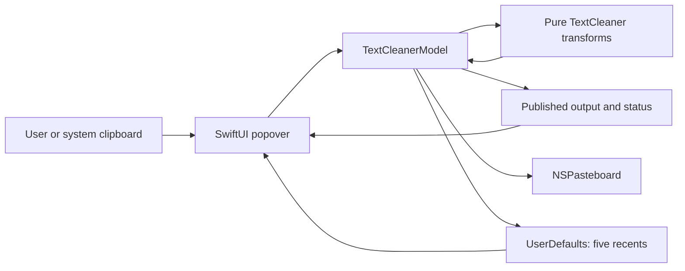

# TextCleaner Repository Learning Report

- **Evidence snapshot:** 2026-07-20, commit `81fd13a` on `feature/menu-bar-cleaner`
- **Current application version:** 1.1.0, build 2
- **Current release verdict:** `DO-NOT-SHIP` in `RELEASE-QA.md`
- **Audience:** developers who need to understand, maintain, test, or extend TextCleaner

## How to read this report

This report describes the repository as it exists at the evidence snapshot above. Claims use these labels:

- **Implemented** — directly present in current source, tests, configuration, or artifacts.
- **Verified** — exercised successfully during this inspection or recorded as directly exercised in the release evidence.
- **Partial** — present, but incomplete, fragile, or not fully validated.
- **Planned** — documented in a roadmap but absent from the current application.
- **Inferred** — a reasonable interpretation of the code or product context, not direct user-research evidence.
- **Unknown** — the repository does not establish the answer.

The most important distinction is that a green build is not the same as a shippable release. On 2026-07-20, `make verify` built the Release application and printed `ALL TESTS PASSED (45 checks)`. The DMG and ZIP also passed mechanical integrity checks. However, `RELEASE-QA.md` still says `DO-NOT-SHIP` because most installed-app interaction checks could not be performed in the automation session. That is missing release evidence, not proof that all those features are broken.

## 1. Executive overview

TextCleaner is a small, local-only macOS menu-bar utility. A user copies or enters text, chooses a deterministic cleanup or formatting action, and receives a visible output that is also written to the system clipboard. The primary loop is designed to end with a normal paste into another application.

The implementation is a compact, three-layer SwiftUI application:

1. `TextCleaner.swift` is a pure Foundation transformation engine.
2. `TextCleanerModel.swift` owns application state, clipboard I/O, status messages, and recent-output persistence.
3. `TextCleanerApp.swift` defines the menu-bar app and binds controls to model actions.

The repository deliberately has no third-party packages, remote service, database, authentication, analytics, or background worker. It uses SwiftUI and AppKit supplied by macOS. Its architecture is closer to a small desktop utility with a view model than to a service-backed application.

### Current maturity at a glance

| Area | Status | Evidence-based assessment |
|---|---|---|
| Core text transforms | **Implemented / mechanically verified** | All current transform functions have at least basic automated coverage; the current suite passes. |
| Clipboard-to-output contract | **Implemented / mechanically verified on success paths** | Model tests confirm that `Plain Text` and `Clean Clipboard` update output and pasteboard together. Clipboard-write failure behavior exists but is not tested. |
| Menu-bar UI | **Implemented / partially release-verified** | Launch, menu-bar presence, accessory activation, version, and packaging were verified. Most control interactions were not verified in the release QA session. |
| Recent outputs | **Implemented / mechanically verified** | Five-item cap, ordering, deduplication, copying, and persistence are covered by model tests. |
| Build and packaging | **Implemented / verified** | `make build`, `make verify`, DMG validation, ZIP testing, bundle metadata, architecture, and code-signature integrity passed during this inspection. |
| Distribution trust | **Partial** | The application is ad-hoc signed and not notarized. Installation requires a Gatekeeper workaround for downloaded copies. |
| Known transform fixes | **Planned, not shipped** | Wrapped PDF bullet continuations and multi-line title case are recorded bugs; their proposed fixes were reverted because a required manual check could not be performed. |
| Global keyboard shortcut | **Planned, not shipped** | The Control-Shift-Command-C implementation was tested for feasibility and compilation, then reverted because live end-to-end QA was blocked. |
| Release readiness | **Blocked by evidence** | The committed verdict is `DO-NOT-SHIP`; no `v1.1.0` tag exists. |

### The shortest useful mental model



The product invariant lives at the model boundary: a cleanup action computes a value, publishes it as output, writes the same value to `NSPasteboard`, and only then adds it to recents.

## 2. Repository map

The repository is intentionally flat and small. There is no dependency tree, generated source tree, server, or hidden application module.

| Path | Kind | Purpose and ownership |
|---|---|---|
| `TextCleaner/` | Source | The three Swift source files, `Info.plist`, and required icon assets. This is the application target. |
| `TextCleaner.xcodeproj/` | Build configuration | One native macOS application target, two configurations, three compiled Swift files, and one asset catalog. |
| `Tests/` | Test source | A dependency-free standalone Swift test runner. It is intentionally not part of the Xcode app target. |
| `Scripts/` | Release tooling | Reproducible local packaging into DMG and ZIP artifacts. |
| `build/` | Ignored generated output | `make build` places the latest visible `TextCleaner.app` here. It must not be committed. |
| `release/` | Tracked distribution artifacts | Contains only `TextCleaner-1.1.0.dmg` and `.zip`; these are the repository's sanctioned binary release exceptions. |
| `Makefile` | Developer interface | Defines `build`, `test`, `verify`, and `clean`. |
| `README.md` | User/developer entry point | Installation, current shipped behavior, tool list, and build commands. |
| `AGENTS.md` | Execution policy | Defines the product promise, roadmap order, hard gates, architectural invariants, and no-push rule. |
| `PLAN-*.md` | Historical/executable roadmap | Exact implementation and acceptance plans. They document both intended changes and why some changes did not land. |
| `BLOCKERS.md` | Negative evidence | Records failed manual checks, verbatim failure output, attempted work, and reverted plans. |
| `RELEASE-QA.md` | Release evidence | Installed-artifact checklist and explicit `DO-NOT-SHIP` verdict. |
| `.gitignore` | Hygiene rules | Excludes DerivedData, user-specific Xcode state, `.DS_Store`, hidden build output, visible build output, and local assistant settings. |

### Tracked, generated, and machine-local material

- **Tracked source of truth:** Swift source, tests, project configuration, scripts, docs, icon sources, and the two 1.1.0 release archives.
- **Generated but intentionally visible:** `build/TextCleaner.app` is rebuilt from source and ignored by Git.
- **Generated in temporary directories:** Xcode DerivedData and the compiled test executable are created with `mktemp` and deleted by shell traps.
- **Machine-local clutter:** `.DS_Store` files were present in the working tree during inspection, including one under `build/`, but they are ignored and untracked. They are not part of the repository history.
- **Absent by design:** package manifests, package lockfiles, environment files, secret stores, CI definitions, database schemas, migrations, API clients, and server configuration.

## 3. System architecture

### 3.1 Layer responsibilities

#### Transformation layer — `TextCleaner`

`TextCleaner` is an enum used as a namespace for stateless static functions (`TextCleaner/TextCleaner.swift:3`). It imports only Foundation. Every public operation accepts a `String` and returns a `String`; it does not read the clipboard, mutate UI state, persist data, play sounds, or know that it is running inside a macOS app.

This is the strongest architectural boundary in the project. It makes transform behavior deterministic and directly testable with `swiftc`.

#### Application-state layer — `TextCleanerModel`

`TextCleanerModel` is a main-actor `ObservableObject` (`TextCleaner/TextCleanerModel.swift:25`). It owns:

- editable `input`;
- read-only-to-callers `output`, `status`, and `recentOutputs`;
- the selected pasteboard and defaults store;
- action dispatch;
- success and error sounds;
- clipboard read/write behavior;
- five-item recent history and persistence.

This layer adapts pure transforms to product behavior. It is the single place where a cleanup operation becomes a visible output plus a clipboard mutation.

#### Presentation and lifecycle layer — SwiftUI/AppKit

`TextCleanerApp` is the application entry point (`TextCleaner/TextCleanerApp.swift:4`). It creates one `TextCleanerModel` with `@StateObject`, presents `TextCleanerMenu` through `MenuBarExtra`, and uses an AppKit delegate to enforce accessory activation.

`TextCleanerMenu` is a single 540-point-wide popover composed from local computed views and helper functions. It contains no transformation algorithms and no persistence code; it calls model methods.

### 3.2 Dependency direction

The dependency direction is simple and mostly one-way:

```text
SwiftUI/AppKit view → TextCleanerModel → TextCleaner pure functions
                             ├───────→ NSPasteboard
                             ├───────→ UserDefaults
                             └───────→ NSSound
```

The transform engine cannot depend back on AppKit. `AGENTS.md` explicitly protects this invariant. The model depends on AppKit because `NSPasteboard` and `NSSound` are platform APIs. The UI depends on both SwiftUI and AppKit because it is a SwiftUI app that also terminates through `NSApp` and changes activation policy.

### 3.3 Sources of truth and data ownership

There are three distinct sources of truth at runtime:

| Data | Owner/source of truth | Lifetime |
|---|---|---|
| Current editable input | `TextCleanerModel.input` | Current process/model instance |
| Current output and status | `TextCleanerModel.output` and `.status` | Current process/model instance |
| Paste-ready result | The injected `NSPasteboard` | System clipboard lifetime; shared with other apps |
| Recent cleaned values | `UserDefaults["recentOutputs"]`, mirrored in `recentOutputs` | Persists across launches until the defaults domain is removed or overwritten |

The output view never computes its own value. It renders the model's `output`. Likewise, the UI never writes to the pasteboard directly; clipboard ownership is centralized in the model.

### 3.4 Coupling and boundaries

The application has little internal coupling because it is small, but two boundaries matter:

- `TextCleanerAction` couples the UI's buttons and menus to the model's switch statement. Adding an action requires changing both the UI and the action/model mapping, then adding transform tests.
- `TextCleanerModel` directly accepts concrete `NSPasteboard` and `UserDefaults` instances rather than protocols. This is sufficient for isolated success-path tests because both APIs support named instances/suites, but it makes simulated pasteboard-write failure awkward.

No abstraction is obviously premature. Splitting the project into more modules today would add ceremony without solving a current scaling problem.

## 4. Startup and runtime flows

### 4.1 Application startup

1. macOS starts `TextCleanerApp`, the `@main` SwiftUI application.
2. SwiftUI constructs one `TextCleanerModel` as a `@StateObject` (`TextCleanerApp.swift:7`). That model reads persisted recent outputs from `UserDefaults` during initialization (`TextCleanerModel.swift:36-40`).
3. SwiftUI registers a `MenuBarExtra` using the `text.badge.checkmark` SF Symbol and `.window` presentation style (`TextCleanerApp.swift:10-15`).
4. `AppDelegate.applicationDidFinishLaunching` sets `NSApp` to `.accessory` activation policy (`TextCleanerApp.swift:19-22`).
5. `LSUIElement` is also true in `Info.plist:23-24`, reinforcing the no-Dock-icon behavior at bundle configuration level.

There is no conventional app window, navigation stack, route table, document model, onboarding coordinator, or background launch agent.

### 4.2 Opening the popover and automatic clipboard load

When the menu-bar popover appears, `onAppear` calls `loadClipboardIfInputIsEmpty()` (`TextCleanerApp.swift:84-86`).

- If the current input contains any non-whitespace text, the method preserves it.
- If input is empty or whitespace-only, the model asks `NSPasteboard` for `.string` content.
- If plain text exists, both input and output become that text and status becomes `Loaded clipboard text.`
- If no plain text exists, status becomes `Clipboard has no plain text.` and the app beeps.

This behavior avoids silently overwriting in-progress edits every time the popover reopens. It also means a user with existing input must explicitly press `Paste` to replace it with newer clipboard content.

### 4.3 Primary journey: Clean Clipboard

`Clean Clipboard` is the product's central action:

1. The button calls `TextCleanerModel.cleanClipboard()` (`TextCleanerApp.swift:48-50`).
2. The model reads current plain text from the system pasteboard.
3. If there is no string, it reports an error and beeps.
4. Otherwise, it mirrors the clipboard text into `input`.
5. It calls `TextCleaner.smartClean(text)`.
6. It publishes the result to `output`.
7. It clears the pasteboard and writes that same result as `.string`.
8. On successful pasteboard write, it updates status and adds the result to recents.

The corresponding automated test confirms that shouted clipboard text is sentence-cased and written back to the injected pasteboard (`Tests/TextCleanerTests.swift:94-98`).

### 4.4 Manual-input transformation journey

The user may type into the `TextEditor` or press `Paste`, then choose a direct button or menu action.

1. A control passes a `TextCleanerAction` to `model.perform`.
2. The switch chooses a pure transform closure or direct lowercase/uppercase operation.
3. `transformAndCopy` computes the output and publishes it.
4. `copyCleanedOutput` writes the output to the pasteboard.
5. A successful write records the transformed value in recents.

The interface disables transform actions when `input.isEmpty`, and disables the output Copy button by hiding it when output is empty. The model still defends `copyOutput()` against an empty value for programmatic callers.

### 4.5 Output, recents, clear, and quit

- **Copy output:** copies the existing output again but does not add another recent item.
- **Select a recent:** checks that the value still exists, publishes it as output, and copies it. It does not alter ordering.
- **Record a recent:** trims outer whitespace, ignores an empty result, removes duplicates, inserts newest first, caps at five, and writes the array to `UserDefaults` (`TextCleanerModel.swift:190-200`).
- **Clear:** empties input and output and sets status to `Cleared.` It intentionally does not erase the clipboard or recent history.
- **Quit:** calls `NSApp.terminate(nil)` from the popover header.

### 4.6 Failure, retry, cancellation, and restart behavior

This is a synchronous local application; it has no network request, loading spinner, retry queue, or cancellation flow.

The explicit error paths are:

- no plain text on the clipboard;
- no output available to copy;
- a selected recent no longer exists;
- `NSPasteboard.setString` returns false.

Each sets a status string and plays the standard error beep. Retrying means fixing the input/clipboard state and pressing the action again.

On restart, recent outputs are restored. Input, output, and status reset to their initial values; the next popover appearance may load the current clipboard. There is no crash recovery or unsaved-input restoration.

## 5. Transformation engine

### 5.1 Smart Clean decision path

`smartClean` is not an AI model and does not infer document semantics. It is a deterministic pipeline (`TextCleaner.swift:4-13`):

1. Normalize newlines, non-breaking spaces, and inline whitespace.
2. Repair PDF-style hard line breaks using punctuation and list heuristics.
3. Count letters; if there are at least 12 and more than 72% are uppercase, lowercase the text and capitalize the first letter and letters after `.`, `!`, or `?`.
4. Otherwise, retain the normalized/fixed capitalization.

This is fast, private, understandable, and testable. It can also make linguistically wrong choices because it has no knowledge of proper nouns, acronyms, abbreviations, locale-specific title rules, or document structure beyond its heuristics.

### 5.2 Current transform behavior

| Capability | Implemented behavior | Important boundary or limitation |
|---|---|---|
| Plain Text | Converts CRLF/CR to LF, replaces non-breaking spaces, collapses whitespace within each line, trims outer whitespace, preserves internal blank lines. | It operates on `.string` clipboard content; it does not preserve rich text, links, styles, or attachments. |
| PDF Lines | Joins non-punctuated wrapped lines, removes a line-ending hyphen before joining, preserves blank paragraphs, and groups recognized bullets/numbered items. | **Known bug:** a continuation line after a bullet becomes a separate paragraph. The planned fix did not ship. |
| Smart Clean | Runs Plain Text + PDF Lines, then sentence-cases mostly-uppercase content. | The 12-letter/72% heuristic is fixed and not user-configurable. Proper nouns and acronyms may be lowercased. |
| Sentence | Lowercases everything, then capitalizes the first letter and letters after `.`, `?`, or `!`. | Not grammar-aware; abbreviations and proper nouns are not preserved. |
| Title Case | Capitalizes space-separated words except a fixed list of small words after the first token. | **Known bug:** the first word after a newline is not reliably capitalized. Punctuation-aware title rules are not implemented. |
| Lowercase / Uppercase | Uses Swift's built-in Unicode-aware string casing. | Operates on the whole raw input without whitespace normalization. |
| Markdown Quote | Normalizes text and prefixes each line; blank lines become `>`. | Does not parse existing Markdown or prevent double-formatting. |
| Markdown Bullet List | Removes empty lines and prefixes meaningful lines with `- `. | Existing bullet syntax is not detected or replaced. |
| Comma List | Removes empty lines and joins meaningful lines with `, `. | Does not quote commas already inside values. It is not CSV generation. |
| Markdown Bold / Italic | Wraps each meaningful line with `**` or `*`. | Existing delimiters are not escaped. |
| Markdown Code | Wraps lines in backticks; if a line contains a backtick, uses spaced double-backtick delimiters. | It is a pragmatic inline formatter, not a complete CommonMark delimiter algorithm. |
| Chat formatting | Wraps meaningful lines with single asterisks, underscores, backticks, or tildes. | Assumes the destination chat app recognizes those conventions. |

### 5.3 PDF-line algorithm in detail

`fixPDFLines` builds paragraph blocks from normalized lines (`TextCleaner.swift:26-61`):

- a blank line flushes the current paragraph;
- a recognized list item flushes the current paragraph and is appended into a list block;
- a normal line joins the accumulator unless the previous text ends with `.`, `!`, `?`, `;`, or `:`;
- a trailing hyphen is removed before joining;
- final blocks are separated by two newlines, while list entries within a block use one newline.

Recognized list prefixes are `- `, `* `, `• `, `– `, `— `, digits followed by `. `, and digits followed by `) ` (`TextCleaner.swift:222-237`).

The known wrapped-bullet defect comes from appending a bullet immediately and resetting the accumulator. Its continuation has no active list item to join. `PLAN-fix-transform-bugs.md` contains a tested code design and five additional regression checks, but the current source and 45-check suite intentionally remain at the pre-fix behavior because the plan's mandatory UI spot check was blocked.

## 6. Module and file guide

### Application files

| File | Public responsibility | Called by / depends on | Maintainability notes |
|---|---|---|---|
| `TextCleaner/TextCleaner.swift` | Defines every pure transformation. | Called by `TextCleanerModel`; depends only on Foundation. | Best place for correctness work. Preserve AppKit independence and add exact regression cases for every semantic change. |
| `TextCleaner/TextCleanerModel.swift` | Owns app state, action dispatch, clipboard I/O, sounds, status, and recents. | Called by SwiftUI; depends on `TextCleaner`, AppKit, Foundation. | The injectable initializer is essential. The action switch is explicit and appropriate at this size. |
| `TextCleaner/TextCleanerApp.swift` | App entry, menu-bar lifecycle, layout, controls, output and recent views. | Calls model methods; depends on SwiftUI and AppKit. | All UI is in one 245-line file. This is still manageable, though UI testability is limited. |
| `TextCleaner/Info.plist` | Bundle identity placeholders, minimum OS, accessory-app declaration. | Expanded by Xcode build settings. | `LSUIElement` is a product invariant. |
| `TextCleaner/Assets.xcassets/` | Complete macOS icon set and asset-catalog metadata. | Compiled by Xcode into `Assets.car` and `AppIcon.icns`. | All standard 16–512 point 1x/2x icon slots are populated. |
| `TextCleaner.xcodeproj/project.pbxproj` | Defines the single application target and build settings. | Used by Xcode/xcodebuild. | Hand editing is intentionally restricted. Version is 1.1.0/build 2; deployment target is macOS 13.0; bundle ID is `com.dewflash.TextCleaner`. |

### Test and delivery files

| File | Responsibility | Important behavior |
|---|---|---|
| `Tests/TextCleanerTests.swift` | Standalone test runner with 45 exact checks. | Compiled with the two non-UI source files; uses a named pasteboard and isolated defaults suite so tests do not alter the user's real clipboard/history. |
| `Makefile` | Human-facing build/test commands. | Builds Release into temporary DerivedData, copies only the app to `build/`, and compiles tests into a temporary directory. |
| `Scripts/package.sh` | Rebuilds current DMG and ZIP from `MARKETING_VERSION`. | Calls `make build`, stages an installable app plus `INSTALL.txt`, replaces `release/`, and suppresses resource-fork/quarantine metadata. |
| `README.md` | Current user instructions and shipped tool list. | Correctly omits the unshipped global hotkey and wrapped-bullet claim. |
| `RELEASE-QA.md` | Installed-artifact release checklist. | Records four passes, multiple blocked interaction rows, two not-shipped rows, and `DO-NOT-SHIP`. |
| `BLOCKERS.md` | Failure and attempted-remediation log. | Establishes why transform fixes and hotkey code were reverted and why release QA stayed red. |
| `PLAN-verify-harness.md` | Exact plan that introduced the verification gate. | Landed as commit `d24926f`. |
| `PLAN-fix-transform-bugs.md` | Exact planned implementation for two transform defects. | Automated 50-check version passed temporarily, but the plan was reverted at its required UI criterion. |
| `PLAN-clipboard-hotkey.md` | Exact Carbon global-hotkey plan. | Feasibility and typechecking passed temporarily; live cross-app verification was blocked, so it was reverted. |
| `PLAN-final-polish.md` | Versioning, packaging, README, and release QA plan. | Landed with an honest `DO-NOT-SHIP` outcome as allowed by the plan. |

## 7. Swift and framework concepts as used here

### `@main` and `App`

`@main struct TextCleanerApp: App` tells Swift that this SwiftUI type is the executable entry point. Its `body` returns a `Scene`, but the scene is a `MenuBarExtra`, not a normal `WindowGroup`. This is why the app behaves like a utility in the menu bar rather than a document or windowed application.

### `@StateObject` and `@ObservedObject`

The app creates and owns the model with `@StateObject`. SwiftUI preserves that model across view redraws. `TextCleanerMenu` receives the same object through `@ObservedObject`, meaning the child observes it but does not own its lifetime.

If the menu view created a fresh model every time, clipboard output, status, and recents could reset unexpectedly. The current ownership is correct for one application-level model.

### `ObservableObject` and `@Published`

The model's published properties notify SwiftUI when input, output, status, or recents change. SwiftUI then reevaluates the view and updates only affected presentation. `private(set)` allows views to read output/status/recents while forcing mutations through model behavior.

### `@MainActor`

The entire model is isolated to the main actor. This guarantees UI-observed state and AppKit clipboard/sound calls occur in the main-thread domain. There is no async workload today, so no actor hopping occurs in the shipped application.

### Dependency injection without a framework

`init(pasteboard:defaults:)` defaults to `.general` and `.standard` in production but lets tests provide named, isolated instances. This is dependency injection in its simplest useful form: callers select side-effect destinations without introducing protocols, containers, or external libraries.

### Value transformations and closures

`transformAndCopy` accepts a `(String) -> String` closure. Each action supplies the appropriate transform, allowing one shared sequence—compute, publish, copy, record—to enforce the product contract. This is local functional composition rather than a generic framework.

### Platform APIs

- `NSPasteboard` reads/writes system clipboard strings.
- `UserDefaults` stores a small property-list-compatible string array.
- `NSSound.beep()` reports errors without a custom alert surface.
- `NSApplicationDelegate` sets accessory activation.
- `NSApp.terminate(nil)` exits from the popover.
- SF Symbols provide button and menu-bar icons by system name.

## 8. Data architecture and privacy

### 8.1 Data model

There are no domain entities, schemas, relational records, files, caches, migrations, or sync conflicts. The complete persisted application data model is effectively:

```text
recentOutputs: [String]  // newest first, unique, maximum 5
```

The storage key is the unversioned string `recentOutputs`. `UserDefaults.stringArray(forKey:)` provides basic type validation: a missing or incompatible value results in an empty array. No migration is currently necessary because there is only one field and one representation.

### 8.2 Derived data

- `canCleanClipboard` is computed from current pasteboard string availability.
- recent previews replace line breaks with ` / ` and truncate after 72 characters; this is view-only and not persisted.
- output is derived from input for manual actions or clipboard input for `Clean Clipboard`.
- build and release artifacts are derived from source and project configuration.

### 8.3 Privacy boundary

**Implemented:** no network/API code, telemetry, account, login, remote database, or cloud sync appears in the repository. Transformations run in-process.

Clipboard text is not entirely ephemeral: the latest five successfully transformed non-empty outputs are persisted in standard `UserDefaults`. That is a local convenience feature, but it can retain sensitive copied text across relaunches. The UI exposes no “clear recents” action and no preference to disable history. The normal `Clear` button does not remove those values.

The system clipboard itself is shared operating-system state. TextCleaner clears it and writes plain text; other processes with clipboard access may subsequently read it. This is normal clipboard behavior, not a remote upload.

## 9. UI and product structure

### 9.1 Single-surface layout

The application has one popover surface, fixed at 540 points wide with 14 points of outer padding (`TextCleanerApp.swift:81-86`). From top to bottom it contains:

1. title, status, and Quit;
2. full-width monospaced input editor, 120 points high;
3. Paste, Clean Clipboard, and Clear;
4. Plain Text, PDF Lines, and Smart Clean;
5. Sentence, Case, Markdown, and Chat controls;
6. output heading, conditional Copy button, and 110-point scrollable monospaced output;
7. Recent empty state or up to five one-line recent buttons.

The input editor's full-width layout was corrected in commit `81fd13a` by replacing a hard-coded 430-point width with `maxWidth: .infinity`. The regenerated release artifacts were committed with the same change.

### 9.2 View states

- **Initial:** status asks the user to paste or clean; output and recents may be empty.
- **Clipboard loaded:** input and output mirror clipboard text.
- **Transformed:** output, clipboard, status, and recents update.
- **No output:** output panel shows `Cleaned text will appear here.` and hides Copy.
- **No recents:** a descriptive empty state is shown.
- **Error:** status text changes and the system beep plays; no modal alert appears.

There is no asynchronous loading state because every operation is local and synchronous.

### 9.3 Accessibility and keyboard behavior

Most controls use `Label` with visible text and SF Symbols, giving assistive technologies meaningful default labels. Output text supports selection. The Quit control has a `q` keyboard shortcut.

However, the app has no explicit accessibility identifiers, help text, focus-order customization, action keyboard shortcuts, automated UI tests, or documented VoiceOver review. The release automation's inability to obtain Accessibility permission is not evidence that end users need that permission; it blocked System Events from controlling the UI.

## 10. Testing and reliability

### 10.1 Current strategy

`make verify` has two sequential gates:

1. `make build` creates temporary Xcode DerivedData, builds the Release scheme, copies only `TextCleaner.app` to `build/`, then deletes DerivedData.
2. `make test` compiles `TextCleaner.swift`, `TextCleanerModel.swift`, and the standalone test runner with `swiftc -parse-as-library`; it runs the executable and deletes it.

The SwiftUI entry file is deliberately excluded from the test executable because both it and the runner declare `@main`.

### 10.2 Coverage represented by the 45 checks

The suite contains 28 transformation checks and 17 model checks:

- newline, non-breaking-space, whitespace, and blank-line normalization;
- PDF line joining, paragraph preservation, dehyphenation, punctuation boundaries, and basic lists;
- uppercase detection and Smart Clean behavior;
- sentence and title casing;
- every Markdown and chat formatting operation;
- pasteboard loading;
- Plain Text and Clean Clipboard output-to-pasteboard behavior;
- recent insertion, ordering, cap, eviction, deduplication, copy, and persistence;
- clear behavior;
- clipboard-availability computation.

The test pasteboard and defaults suite are isolated. Running tests does not intentionally overwrite the user's real clipboard or recents.

### 10.3 Verification performed for this report

On 2026-07-20:

- `make verify` exited 0 and printed `ALL TESTS PASSED (45 checks)` after being allowed normal access to Swift/Xcode compiler caches;
- `build/TextCleaner.app` passed strict deep signature verification;
- the built executable was a thin arm64 Mach-O;
- the built bundle reported version 1.1.0/build 2, minimum macOS 13.0, and `LSUIElement = true`;
- `hdiutil verify release/TextCleaner-1.1.0.dmg` reported a valid checksum;
- `unzip -t release/TextCleaner-1.1.0.zip` reported no errors;
- the app extracted from the ZIP passed code-signature verification and reported the expected metadata;
- the ZIP contained the wrapper directory, app executable, icon, asset catalog, signature resources, and `INSTALL.txt`.

### 10.4 Reliability gaps

The highest-value missing tests are:

1. the two known transform regressions from `PLAN-fix-transform-bugs.md`;
2. pasteboard failure and no-text error branches;
3. every `TextCleanerAction` mapping through the model, not just selected paths;
4. output/clipboard equality for lowercase, uppercase, Markdown, chat, and recent actions;
5. UI-level action wiring, enabled/disabled state, status text, popover appearance, and accessibility;
6. very large input and unusual Unicode behavior;
7. packaging validation as a repeatable command rather than a manual collection of commands.

There is no CI. Verification depends on a logged-in macOS development machine with Xcode and pasteboard services.

## 11. Build and release

### 11.1 Requirements

- macOS development machine;
- Xcode and command-line Swift tools;
- logged-in GUI session for pasteboard-backed tests;
- no external dependency installation;
- no environment variables or secrets.

The current evidence machine used Xcode 26.5 and Swift 6.3.2 while the Xcode project declares Swift language mode 5.0. The built app targets macOS 13.0 or later.

### 11.2 Commands

```bash
make build
make test
make verify
make clean
Scripts/package.sh
```

- `make build` leaves `build/TextCleaner.app` and no persistent DerivedData.
- `make test` runs only the standalone test executable.
- `make verify` is the required build-plus-test gate.
- `make clean` removes legacy `.build/` and current `build/` outputs.
- `Scripts/package.sh` rebuilds the app, replaces `release/`, and creates versioned DMG and ZIP files.

### 11.3 Packaging layout

The DMG exposes `TextCleaner.app` and `INSTALL.txt` at its root. The ZIP contains a `TextCleaner-1.1.0/` wrapper with the same two items. Extended attributes, quarantine metadata, ACLs, and resource forks are suppressed during copying/archiving to avoid AppleDouble clutter.

### 11.4 Signing and distribution

The current app has a valid ad-hoc signature, no team identifier, and no notarization. This proves the bundle has not been modified since signing, but it does not provide a third-party-verifiable developer identity or standard Gatekeeper trust for internet distribution.

The repository README tells users to Control-click and choose Open if macOS warns about an unidentified developer. That is accurate for the current distribution, but it is a meaningful adoption and trust cost.

The release directory contains no checksums, release notes, provenance attestation, or notarization ticket. Artifacts are committed to Git, and `package.sh` makes their layout reproducible, but byte-for-byte reproducibility is not established.

## 12. Architectural critique

### 12.1 What is strong

1. **Pure transformation core.** Text algorithms are separate from UI and platform side effects, making them easy to reason about and test.
2. **A real product invariant.** Cleanup actions converge on one compute-publish-copy-record path rather than duplicating clipboard behavior in every button.
3. **Appropriate dependency injection.** Named pasteboard/defaults instances give useful test isolation without framework overhead.
4. **Small operational footprint.** No network, account, server, vendor SDK, database, or runtime package means low latency, no infrastructure bill, and a narrow privacy surface.
5. **Honest release evidence.** Blocked tests were recorded as failures rather than relabeled as passes; unshipped features were removed from README claims.
6. **Clean build outputs.** Temporary compilation directories are cleaned automatically, while the user-facing app remains easy to find under `build/`.

### 12.2 Risks and confusing areas

| Priority | Finding | Why it matters | Recommended response |
|---|---|---|---|
| P0 | Release verdict is still `DO-NOT-SHIP`. | The repository cannot truthfully claim the installed UI flow is release-approved. | Perform the blocked QA rows in a normal logged-in macOS session with direct human interaction; record actual results before changing the verdict or tagging. |
| P1 | Wrapped bullet continuations and multi-line title case are known wrong behaviors. | Both affect advertised transformation capabilities. | Land the exact regression tests and fixes only when their complete gate, including manual verification, can be performed. |
| P1 | The “clipboard always holds exactly what the app shows” promise has an unavoidable failure branch. | If `setString` fails, output is already changed while clipboard write fails. The status reports the failure, but the literal “always” claim no longer holds. | Define the invariant as “after a successful action,” or delay publishing output until clipboard write succeeds. Add a testable clipboard adapter if failure simulation becomes important. |
| P1 | Ad-hoc signing and no notarization create install friction. | External users see a security warning and must use a workaround. | If public distribution is intended, obtain Developer ID signing and notarize/staple artifacts; keep ad-hoc builds for local development. |
| P2 | Interactive behavior lacks automated coverage. | Button wiring, popover state, layout, focus, and status can regress while 45 tests stay green. | Add a small UI test target or a documented human smoke test that can run without automation privileges. This would require an intentional project-policy change. |
| P2 | Recents persist copied text without an erase-history control. | Sensitive snippets can remain on disk and visible after relaunch. | Add “Clear Recents” and, if users request it, an option to disable history. Document local persistence. |
| P2 | Recent storage trims output independently. | Lowercase/uppercase can preserve outer whitespace in output/clipboard while history stores a trimmed variant. Re-copying the recent may not reproduce the exact previous output. | Decide whether recents should preserve exact output or whether all actions should normalize outer whitespace, then test the chosen invariant. |
| P2 | All transforms run synchronously on the main actor. | Very large clipboard contents may temporarily block the popover. | Measure realistic large inputs first. Move pure transformation work off the main actor only if profiling shows a user-visible problem. |
| P3 | The title and sentence algorithms are deliberately naive. | Proper nouns, acronyms, abbreviations, punctuation, and locales may be transformed incorrectly. | Define supported semantics with user examples before increasing algorithm complexity. Keep deterministic behavior and regression tests. |
| P3 | Action availability observes external clipboard state only when SwiftUI reevaluates. | A clipboard change while the popover remains open may not immediately refresh the Clean Clipboard enabled state. | Verify the behavior manually. Add pasteboard change-count observation only if it is a real usability problem. |

### 12.3 Scaling outlook

The present architecture is appropriately sized for a utility with roughly a dozen deterministic operations. The first scaling pressure will not be CPU or infrastructure; it will be semantic complexity and UI discoverability.

If transforms gain options, per-destination presets, undo, or user-defined pipelines, a single action enum and one popover may become crowded. At that point, separate transform descriptors and settings state could help. Introducing those abstractions now would be premature.

## 13. Learning summary

### The durable mental model

TextCleaner is one synchronous pipeline around strings:

```text
clipboard or editor → pure transform → model output → clipboard → optional recent history
```

Everything important follows from keeping those stages distinct. Transform correctness belongs in pure tests. Clipboard, history, and status behavior belong in model tests. Layout and interaction belong in UI/manual QA. Packaging must be tested from the artifact users actually install.

### Lessons from the repository history

- The project started with the right transform/model/UI separation.
- The product promise that every action copies output was strengthened soon after the initial build.
- Features and presentation grew before a test gate existed; the 45-check harness arrived later.
- Reproducible packaging and explicit release QA also arrived after stale/wrong-version artifacts had existed.
- The roadmap correctly treated inability to perform manual checks as a blocker, even when compilation and unit tests passed.

The main process lesson is that automated transform tests, artifact packaging, and a performable interactive QA path should be established before release-candidate feature work.

### How a new developer should make a safe first change

1. Read `AGENTS.md`, the relevant plan, `BLOCKERS.md`, and `RELEASE-QA.md`; do not assume every documented plan shipped.
2. Identify whether the change belongs to transformation, model behavior, UI, or packaging.
3. For a transform change, write an exact input/output regression case first in `Tests/TextCleanerTests.swift`.
4. Keep `TextCleaner.swift` Foundation-only and preserve `TextCleanerModel.init(pasteboard:defaults:)`.
5. Make the smallest implementation change and run `make verify`.
6. Exercise the real UI behavior in a built app. For release work, test the installed app from the packaged DMG, not only `build/TextCleaner.app`.
7. Confirm output and clipboard are identical after every successful cleaning action.
8. Review `git status` so generated app/cache files are not committed.
9. Update user documentation only for behavior that is actually present and verified.
10. Keep a failed manual criterion visible; never convert missing evidence into a pass.

## 14. Unknowns and evidence limits

- This report did not perform the blocked popover interaction rows; it does not replace `RELEASE-QA.md`.
- No external market research, user interviews, usage analytics, crash telemetry, performance profiles, or accessibility audit exists in the inspected repository.
- The repository does not establish active-user count, usage frequency, retention, willingness to install an unnotarized app, or the most valuable transform.
- There is no evidence for Intel compatibility in the current artifacts; the current built and packaged executable is arm64, matching the README's Apple Silicon requirement.
- The repository does not establish App Store eligibility or a public distribution channel beyond committed DMG/ZIP files.
- The committed release artifact was generated with the current source change in commit `81fd13a`, but byte-for-byte reproducible builds are not established.

These are not accusations of failure. They are boundaries on what can be concluded from the available evidence.
